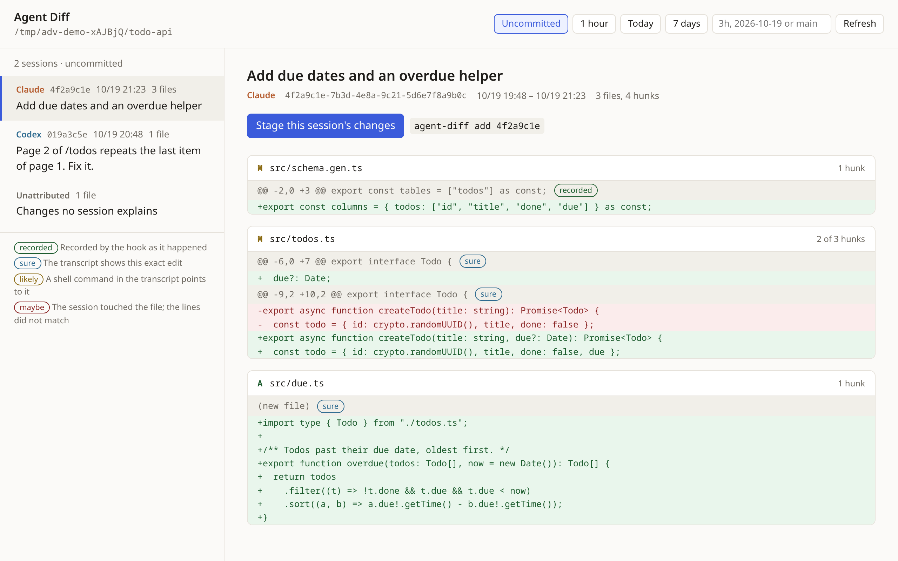

# AgentDiffViewer

When several Claude Code and Codex sessions work in the same checkout, `git status` mixes their
changes. `agent-diff` tells you which session made each change, down to the hunk. It shows this
in a local diff viewer or in the terminal, and it can stage exactly one session's work.



It works from two sources that fill each other's gaps:

- **Transcripts.** Claude Code (`~/.claude/projects`) and Codex (`~/.codex/sessions`) already
  log every edit. This works with no setup, for past sessions too.
- **Hooks** (optional, `agent-diff install`). These record the files' contents before and after
  every tool call, so shell commands, code generators and scripts are attributed exactly.

## Install

Node 22.18 or later.

```bash
npm i -g agent-diff-viewer
agent-diff install        # optional: hooks + a skill for Claude Code and Codex
```

`install` adds:

- a PreToolUse/PostToolUse hook to `~/.claude/settings.json` and `~/.codex/hooks.json`;
- the `agent-diff-commit` skill to `~/.claude/skills` and `~/.agents/skills`.

It leaves your other hooks alone and keeps a `.bak-agent-diff` backup. In Codex, run `/hooks` once
and trust the hook. `agent-diff uninstall` removes both.

## Viewer

```bash
agent-diff view                 # prints a http://127.0.0.1:… URL to open
agent-diff view --since today   # start with a wider range
```

Sessions are listed on the left, newest first. On the right are the hunks the selected session
made, each with how sure the attribution is. The buttons at the top choose the range:

| Range | Shows |
|---|---|
| Uncommitted (default) | The working tree and the index vs HEAD |
| 1 hour / Today / 7 days, or `3h`, `2026-10-19 09:00` | Everything since the commit that was HEAD then, including later commits. Only sessions active since that time are considered |
| A branch or commit, e.g. `main` | Everything since that commit |

In the uncommitted range, **Stage this session's changes** shows what would be added, then
stages it. That means whole files the session alone changed, plus only its own hunks of files
shared with other sessions.

The server listens on 127.0.0.1 only. Every request needs the random token in the printed URL,
so other web pages can't read your diffs. Nothing leaves your machine.

## Terminal

```text
$ agent-diff
Claude 4f2a9c1e  10/19 19:48–10/19 21:23  Add due dates and an overdue helper
    M src/schema.gen.ts
    M src/todos.ts (2 of 3 hunks; rest by others)
    A src/due.ts

Codex  019a3c5e  10/19 20:48–10/19 20:48  Page 2 of /todos repeats the last item of page 1. Fix it.
    M src/todos.ts (1 of 3 hunks; rest by others)

Not found in any transcript  (edited by hand, by a tool, or by a session older than --days)
    M README.md

$ agent-diff add 4f2a9c1e      # stage that session's files and hunks, nothing else
$ git commit
```

| Command | |
|---|---|
| `agent-diff` | Changes grouped by session (`--by-file`: one line per file) |
| `agent-diff show <session>` | The hunks a session made, as a diff |
| `agent-diff add <session>` | Stage the session's changes (`--dry-run` to preview) |
| `agent-diff view` | The viewer (`--port` to fix the port) |
| `agent-diff install` / `uninstall` | Hooks and skill for Claude Code and Codex (`--agent claude\|codex` for one) |

| Option | |
|---|---|
| `--since <time>` | `2h`, `1d`, `today` or a date: changes since then, commits included |
| `--base <ref>` | Changes since a branch or commit |
| `--self` | With `show` / `add`: the session running the command (reads `CLAUDE_CODE_SESSION_ID` / `CODEX_THREAD_ID`) |
| `--json` | Machine-readable output |
| `-C <dir>` | Run in another repository |
| `--days <n>` | How far back transcripts are read (default 30) |

`<session>` is an id prefix, optionally starting with `claude:` or `codex:`.

## Agents committing their own work

With several sessions in one checkout, an agent's `git add -A` sweeps up everyone's half-done
changes. The `agent-diff-commit` skill tells the agent to stage with `agent-diff add --self`
instead, and to check `git diff --cached` before committing.

## How it decides

For each changed file, agent-diff only considers sessions active after the file's last commit
(or after `--since`). A hunk goes to the session whose writes contain most of its lines:

| Evidence | Confidence |
|---|---|
| The hook recorded the session changing those lines (any tool, shell included) | recorded |
| Edit / Write / MultiEdit calls (Claude), FileChange diffs and apply_patch (Codex) | sure |
| A recorded delete or create of that very file (moves included) | sure |
| Text of a shell command or Codex `exec` script that mentions the file (sed, heredocs, scripts) | likely |
| The same substitution (old → new fragment) that the session made in another file, as a codemod does | likely |
| The only session that touched the file, for a hunk with nothing to match (whitespace) | maybe |

Anything else is unattributed: edits by hand, by formatters, or by sessions older than `--days`
that the hooks did not see. The hooks keep their records in `.git/agent-diff/` of each
repository. One record is the before and after content of a tool call, stored as git blobs.

## Development

```bash
npm ci
npm test               # node:test, against temporary repositories and fake transcripts
npm run typecheck
npm run screenshots    # rebuilds docs/screenshots from a demo repository (Playwright)
```

Releases: bump `version` in package.json and push it to the `publish` branch. GitHub Actions
publishes to npm with trusted publishing.

## License

MIT
